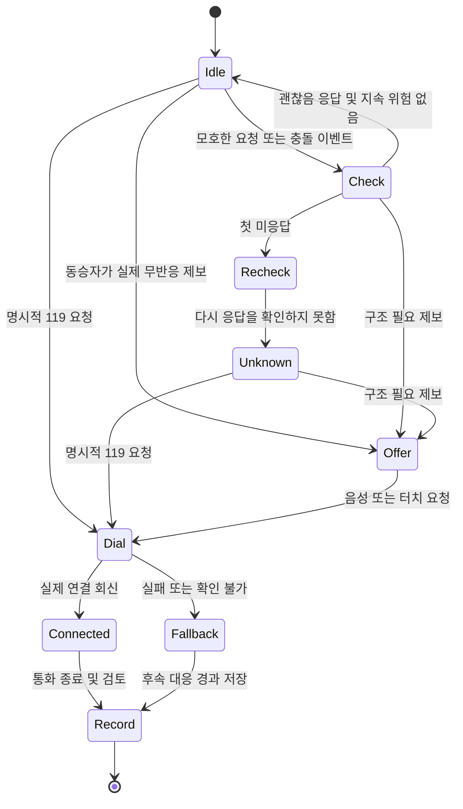

# DriveCheck MVP 구현 규칙

디자인 기준 v12. 현재 문서는 개발 계획이다. 아래 이름은 앱 내부의 데이터·모듈 명칭이다.

## 1 범위

| 우선순위 | 기능 | 완료 기준 |
| --- | --- | --- |
| P0 핵심 | 음성·큰 버튼 입력 | 최종 음성 결과 또는 터치 입력으로 직접 119·동승자 제보·모호한 요청이 구분된다. 인식 실패 시 터치 진입을 유지한다. |
| P0 핵심 | 차량 위치와 대응 상태 | Pleos FusedLocation을 검증하고, 지원 환경에서 Brake 등 차량 상태를 읽는다. 직접 요청은 질문을 건너뛴다. 호출 요청·화면 열림·연결·실패·미확인을 구분한다. |
| P0 핵심 | 사건 기록 및 정차 후 내보내기 | 동일 사건 ID로 관측·진술·실행 회신을 앱에 저장한다. 재실행 후 확인할 수 있고 사용자 선택 항목을 PDF로 생성해 시스템 공유를 사용한다. |
| P1 부가 | 보호자 알림, 휴대폰 이어보기, 의료 카드, 112·견인·보험사 선택 | 사전 등록·동의·취소·오프라인 실패 흐름을 각각 시험한다. P0은 해당 기능의 추가 여부와 독립적으로 작동한다. |
| P2 승인 연동 | 충돌·에어백·운전자 감지, 제조사 정차·비상등 회신, 회선 AI, 기관 의료·보험 전송, 등록 화자 추정 | 차종·권한·회선·기관·동의 범위가 검증된 경우에만 실제 기능으로 표시한다. 공모전 대표 시연에는 출처가 명시된 테스트 이벤트를 사용한다. |

## 2 상태 전이 UML

위치는 발신 또는 위치 확인 요청과 병렬로 읽는다. 실제 연결 여부와 무관하게 가용 위치를 저장하되, 주소·갱신 시각의 상태는 연결 상태와 독립적이다. 명시적 119는 확인 대기 중에도 우선한다. UI가 플랫폼에 의해 제한된 때는 허용된 동작만 표시한다.

## 3 필수 동작 규칙

1. **입력** 최종 발화만 의도 판정에 사용한다. ‘연기가 없어요’ 같은 부정 표현, 겹친 발화, TTS 반향, 중간 결과로 긴급 신고를 확정하지 않는다. 앱에 답이 없다는 사실은 의식 상태 판단이나 자동 발신·정차의 조건이 될 수 없다.
2. **차량 상태** 플랫폼의 CarUxRestrictions로 조작 제한을 결정한다. 0 km/h 한 번이나 브레이크 페달 입력만으로 주차를 확정하지 않는다. 주행·상태 미확인 때 편집·설정·모션을 제한한다. 제조사 제어와 공식 SOS 우선 흐름을 유지한다.
3. **전화** `requested → dialer_opened → connected | failed | unknown`을 구분한다. 확인 가능한 활성 SOS가 있으면 중복 요청하지 않는다. 승인과 회신을 확인하기 전 실제 연결은 `unknown`이다. 시연용 어댑터는 시스템 발신·차량 제어·실제 외부 전송을 호출할 수 없다.
4. **위치** `available | stale | denied | unavailable`을 기록한다. 출처·시각·제공된 정확도와 좌표를 보존한다. 좌표를 주소로 표시하려면 변환 성공을 확인한다. 유효 위치가 없더라도 전화 안내를 계속한다.
5. **사건 기록** `Incident`와 `Event`를 분리한다. 이벤트에 `eventId, incidentId, source, kind, observedAt, receivedAt, outcome`을 둔다. 원본은 유지하고 정정 메모·보고서 버전을 별도 보관한다. 관측·진술·앱 판단·모의 입력의 출처를 UI와 내보내기에 남긴다.
6. **보관과 공유** 중간 자막과 통화 원음은 기록에 넣지 않는다. 사건에 필요한 확정 자막은 별도 저장하는 안을 사용하고 기본 PDF에서는 해제한다. 의료·화자 특징값은 MVP 수집 대상에서 분리한다. 실제 보관 기간·삭제·접근 조건은 배포 전에 확정한다.
7. **추가 기능** 알림 발송과 취소 중 한 상태만 확정한다. 시연 취소 시간 10초와 운전자 재확인 시간은 별개다. 취소·만료 건은 재시도하지 않는다. AI 답변은 승인된 통화에서만 사용하고, 직접 말하기는 기존 통화를 유지하며 합성 발언을 중단한다.

## 4 코딩 순서와 완료 검사

| 단계 | 작업 | 증빙 |
| --- | --- | --- |
| M0 | Pleos SDK 프로젝트 생성, 공식 에뮬레이터 실행, 권한과 지원 상태 로그 확인 | 설치·실행 로그, SDK·이미지 버전, 승인 상태 기록 |
| M1 | `SpeechInput`, `LocationSource`, `VehicleStateSource`, `CallGateway`를 앱 내부 인터페이스로 분리 | 권한 거부·지원 없음·지연·실패를 각각 재현 |
| M2 | `IncidentReducer`에서 분기, UI에서 현재 행동과 통화·위치 상태 표현 | 직접 119, 무반응 제보, 두 번째 미응답, 공식 SOS 동시 진행 시험 |
| M3 | Room/SQLite 저장과 정차 후 보고서 생성·공유 | 재시작 뒤 사건 ID·이벤트 순서 확인, PDF 항목 선택 및 가상 데이터 표시 |
| M4 | Kotlin 단위 테스트·에뮬레이터 통합 시험, release 빌드 및 촬영 | 민감정보 없음, 모의/실제 SDK 구분, APK 설치·실행·대표 시나리오 기록 |

P0 완료 게이트는 에뮬레이터 앱 실행과 대표 흐름 완주, STT/위치/차량 상태의 지원 여부 실측, 미지원 경로 재현, 핵심 상태 테스트 통과다. 앱에 직접 연결되는 실제 SDK 입력을 시연에 최소 하나 보여 주고, 사용한 경로와 가상 입력의 범위를 README에 적는다.
